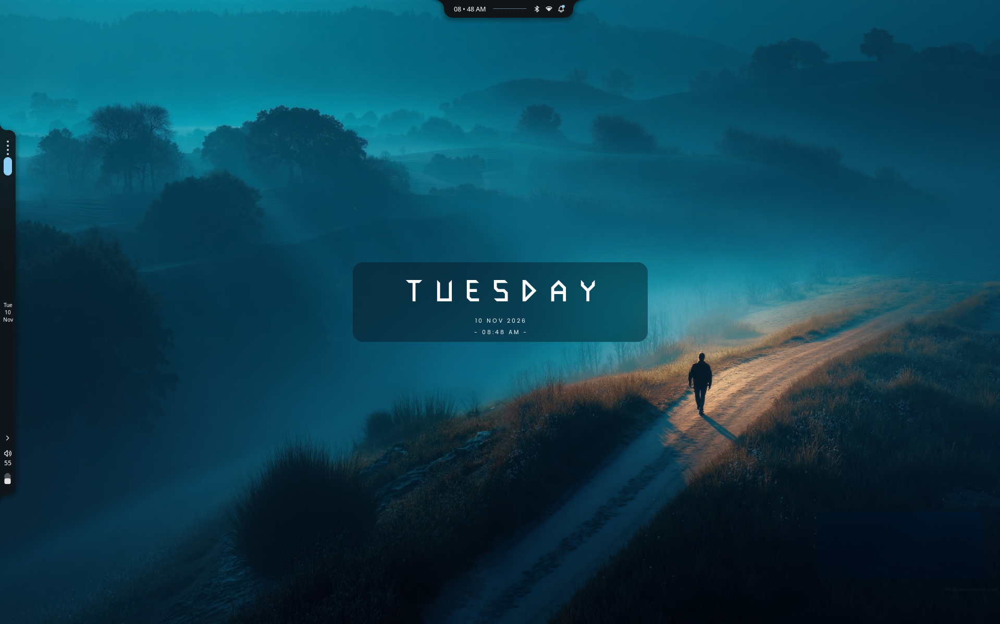
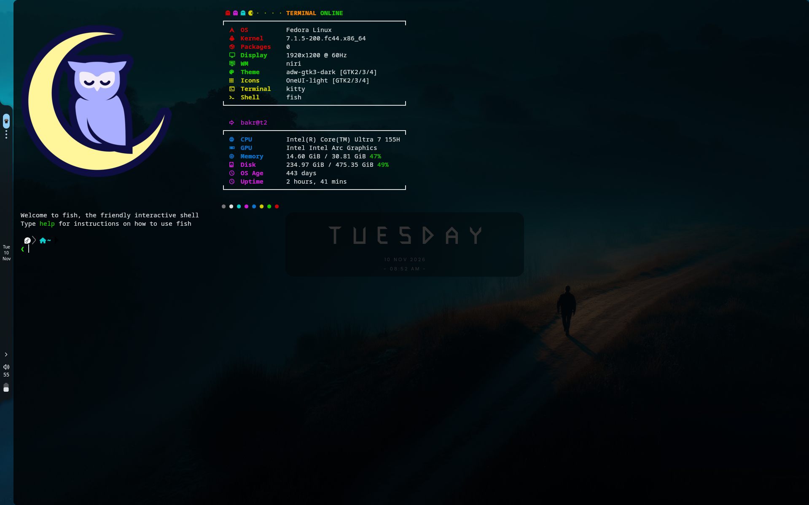
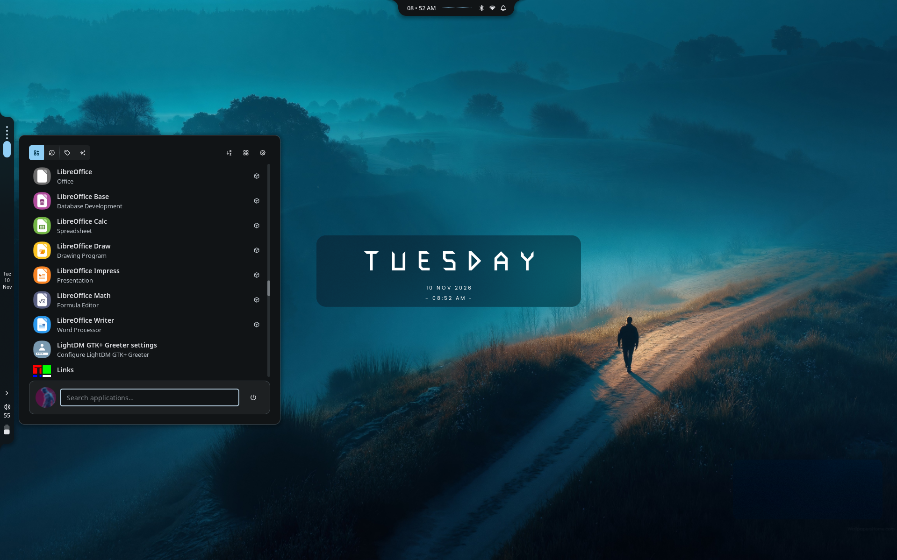
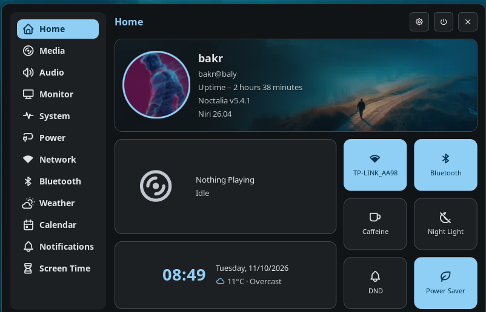
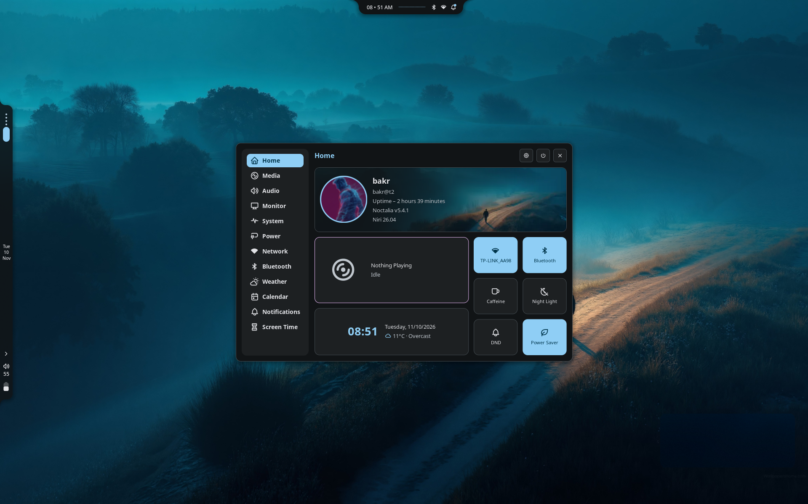

<div align="center">

# 󰣇 bakr's Linux Setup

**A calm, keyboard-driven Fedora desktop — niri + Noctalia + fish + kitty, tuned for the terminal.**

[](https://fedoraproject.org)
[](https://github.com/YaLTeR/niri)
[](https://fishshell.com)
[](https://sw.kovidgoyal.net/kitty/)
[](https://neovim.io)
[](https://github.com/folke/tokyonight.nvim)

</div>

---

## Preview

<div align="center">
  
  <br>
  <sub>Scrolling tiling desktop · Noctalia bar & clock widget · video wallpaper via mpvpaper</sub>
</div>

<br>

<table>
  <tr>
    <td width="50%">
      
      <br>
      <sub><b>fastfetch + fish + kitty</b> — custom ASCII-art-free PNG logo, tide prompt</sub>
    </td>
    <td width="50%">
      
      <br>
      <sub><b>Noctalia launcher</b> — search, app actions, keyboard-first</sub>
    </td>
  </tr>
  <tr>
    <td width="50%">
      
      <br>
      <sub><b>Control center</b> — media, network, bluetooth, night light, power</sub>
    </td>
    <td width="50%">
      
      <br>
      <sub><b>Quick settings</b> — the same panel floating over the desktop</sub>
    </td>
  </tr>
</table>

---

## What's inside

| Component | Choice | Why |
| :-- | :-- | :-- |
| **OS** | Fedora Linux 44 | Bleeding-edge kernel, clean packaging |
| **Compositor** | [niri](https://github.com/YaLTeR/niri) 26.04 | Infinite scrolling tiling, no manual window arranging |
| **Shell / bar** | [Noctalia](https://github.com/noctalia-dev/noctalia) v5.4 | Quickshell-based bar, launcher, control center, notifications |
| **Shell** | [fish](https://fishshell.com) + [tide](https://github.com/IlanCosman/tide) | Sensible defaults, beautiful prompt, zero config noise |
| **Terminal** | [kitty](https://sw.kovidgoyal.net/kitty/) | GPU-accelerated, powerline tabs, Tokyo Night |
| **Multiplexer** | [zellij](https://zellij.dev) | Tabs/panes with a friendly status bar, `Ctrl`-based modes |
| **Editor** | [Neovim](https://neovim.io) + [LazyVim](https://www.lazyvim.org) | Batteries included, easy to extend |
| **Fetcher** | [fastfetch](https://github.com/fastfetch-cli/fastfetch) | Custom layout, PNG mascot, color palette |
| **Wallpaper** | mpvpaper | Animated video wallpaper, muted + looped |
| **Navigation** | zoxide · eza · lazygit · fzf | Jump, list, commit, and find — fast |

**Hardware:** Intel Core Ultra 7 155H · Intel Arc Graphics · 32 GB RAM · 1920×1200 internal + 1920×1080 HDMI.

**Design language:** rounded corners, soft shadows, no borders, Tokyo Night accents, Matugen-synced colors across niri / kitty / Neovim.

---

## Highlights

- **Scrolling tiling that gets out of the way** — columns, workspaces and monitors driven entirely from the keyboard. Minimal chrome, rounded windows, just your work.
- **One shell for everything** — Noctalia handles the bar, launcher (`Mod+Space`), control center (`Alt+S`), clipboard (`Mod+V`), notifications, wallpapers and screenshots.
- **Theme cycling live** — `Mod+Alt+J` / `Mod+Alt+K` cycle Noctalia color schemes; borders, terminal and editor follow.
- **Arabic + English keyboard** — `us,ara` layout with `Alt+Shift` toggle, numlock on boot, natural touchpad scrolling.
- **Terminal-first workflow** — fish aliases for git, `eza` instead of `ls`, `zoxide` jumps, `zellij` layouts, LazyVim for editing.
- **Laptop ↔ monitor aware** — `Mod+P` opens a layout menu (`Laptop Only` / `External Only` / `Dual Monitors`); screenshots and window rules already exclude sensitive apps from screencasts.

---

## Repository layout

```text
.
├── niri/          # niri config.kdl, binds, layout, outputs, colors, theme cycling
├── fish/          # config.fish, aliases, git helpers, fisher + tide
├── kitty/         # kitty.conf, Tokyo Night theme, powerline tab bar
├── nvim/          # LazyVim setup, Matugen color sync, plugin overrides
├── zellij/        # multiplexer config + custom blue-frames theme
├── fastfetch/     # custom fetch layout + PNG logo collection
├── scripts/       # display toggles, lockscreen, timers, helpers
├── wallpapers/    # wallpaper collection
└── screenshots/   # images used in this README
```

---

## Installation

These are **live configs**, so symlink them rather than copying — edits stay in sync.

```bash
git clone <this-repo> ~/mylinux4everything
cd ~/mylinux4everything/niri

# Back up anything you already have
mkdir -p ~/.config-backup
mv ~/.config/niri ~/.config/fish ~/.config/kitty ~/.config/nvim \
   ~/.config/zellij ~/.config/fastfetch ~/.config-backup/ 2>/dev/null

# Link the configs
ln -sfn "$PWD/niri"      ~/.config/niri
ln -sfn "$PWD/fish"      ~/.config/fish
ln -sfn "$PWD/kitty"     ~/.config/kitty
ln -sfn "$PWD/nvim"      ~/.config/nvim
ln -sfn "$PWD/zellij"    ~/.config/zellij
ln -sfn "$PWD/fastfetch" ~/.config/fastfetch
```

Then log into the **niri** session from your display manager.

> **Dependencies:** `niri`, `noctalia` (Quickshell), `kitty`, `fish`, `fisher`, `zellij`, `neovim`, `fastfetch`, `mpvpaper`, `zoxide`, `eza`, `lazygit`, `matugen`. On Fedora most are available via `dnf` or `cargo`; Fisher and LazyVim install their own plugins on first run.

---

## Keybindings

`Mod` = **Super**. Selected essentials from [`niri/binds-noctalia.kdl`](niri/binds-noctalia.kdl):

| Keys | Action |
| :-- | :-- |
| `Mod+Return` | Open kitty |
| `Mod+Backslash` | Open kitty running zellij |
| `Mod+Space` | Application launcher |
| `Alt+S` | Control center |
| `Mod+Tab` / `Mod+U` | Overview |
| `Mod+Q` | Close window |
| `Mod+F` / `Mod+Shift+F` | Maximize column / fullscreen |
| `Mod+H/J/K/L` | Focus left/down/up/right |
| `Mod+Shift+H/J/K/L` | Move window |
| `Mod+1…9` / `Mod+Shift+1…9` | Go to / move to workspace |
| `Mod+R` | Cycle column width presets |
| `Mod+V` | Clipboard manager |
| `Mod+Y` | Wallpaper browser |
| `Mod+P` | Monitor layout menu |
| `Mod+/` | Window switcher |
| `Mod+Alt+J` / `Mod+Alt+K` | Next / previous theme |
| `Print` | Region screenshot |
| `Ctrl+Print` / `Alt+Print` | Fullscreen / window screenshot |
| `Super+X` | Power menu |
| `Mod+Alt+L` | Lock screen |

### Zellij

`Ctrl+p` panes · `Ctrl+t` tabs · `Ctrl+n` resize · `Ctrl+s` scroll · `Ctrl+o` session · `Alt+h/j/k/l` direct focus movement.

---

## Shell quality of life

From [`fish/config.fish`](fish/config.fish):

```fish
alias .. 'z ..'        # zoxide up
alias ls eza           # modern ls
alias zj zellij
alias ff fastfetch
alias lg lazygit
alias oc opencode
alias br 'bun run'
alias tt 'taskwarrior-tui -r today'
```

Plus git wrappers (`add`, `commit`, `push`, `pull`, `branch`, `gs`, `log`, `checkout`, `restore`) that drop the `git` prefix, and `Tab` mapped to `forward-char` for inline completion.

---

## Scripts

| Script | Purpose |
| :-- | :-- |
| [`scripts/display_toggle*.sh`](scripts/) | Switch internal / external / extended display modes |
| [`niri/monitor-switch.sh`](niri/monitor-switch.sh) | niri-native monitor layout switcher bound to `Mod+P` |
| [`niri/cycle-theme.sh`](niri/cycle-theme.sh) | Cycle Noctalia color schemes (`next` / `prev`) |
| [`scripts/lockscreen.sh`](scripts/lockscreen.sh) | Blurred-background lock screen |
| [`scripts/minecraft_timer.sh`](scripts/minecraft_timer.sh) | Friendly "time's up" game timer |
| [`scripts/play_sound.sh`](scripts/play_sound.sh) | Simple notification sound |

---

## Notes

- The `scripts/` folder still contains a few older Hyprland-era helpers (`hyprctl`, `xinput`); the niri equivalents live in `niri/`.
- `niri/layout.kdl` and `niri/colors.kdl` are **auto-generated** — put custom rules in `config.kdl` or a new include.
- Wallpapers and screenshots are included for convenience; swap them for your own.

<div align="center">
  <sub>Built with patience, coffee, and too many dotfiles. 󰣇</sub>
</div>
